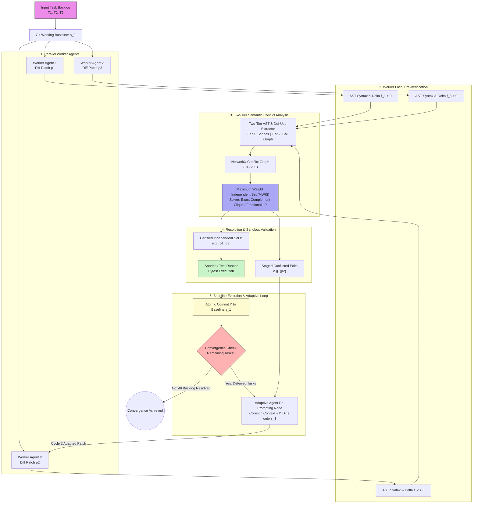

# GraphMerge ⚡
### Parallel AI Agent Collaboration via Graph-Structured Distributed Block Optimization

[](https://opensource.org/licenses/Apache-2.0)
[](https://www.python.org/downloads/)
[](https://arxiv.org/abs/2610.30074)
[](https://langchain-ai.github.io/langgraph/)
[](https://modelcontextprotocol.io/)

> **The world's first open-source reference implementation of *Parallel AI Agent Collaboration as Graph-Structured Distributed Block Optimization* ([arXiv:2610.30074](https://arxiv.org/abs/2610.30074), October 2026).**

---

## 📌 The Problem: The "Merge Degradation" Paradox

When multiple autonomous coding agents (Devin, SWE-agent, AutoGen, CrewAI) operate concurrently on a shared codebase, their independently verified code patches frequently conflict:
* **Syntactic Conflicts:** Overlapping diffs breaking standard `git merge`.
* **Semantic Regressions:** Breaking shared function signatures, cross-file call graphs, or global state.

Current industry solutions either **force agents into an $O(N)$ sequential queue** (painfully slow) or use an **LLM judge** to merge code (stochastic, hallucinations, and code loss).

## 💡 The Solution: Graph-Structured Block Optimization

GraphMerge models parallel multi-agent code integration as **Discrete Block Optimization on a Symbol Conflict Graph $G=(V, E)$**:

1. **Nodes ($V$):** Each proposed agent diff $p_i$.
2. **Edges ($E$):** Semantic AST symbol collisions detected via **Tree-Sitter** across two tiers:
   - *Tier 1:* Syntactic AST function, method, and class scope collisions.
   - *Tier 2:* Cross-file semantic Definition-Use (Def-Use) call graph & import collisions.
3. **Independent Sets ($\mathcal{I}^* \subseteq V$):** Certified conflict-free patch combinations.
4. **Theoretical Guarantee:** Proved in *arXiv:2610.30074*, an optimal fractional coloring preserves at least a **$\frac{1}{\chi_f(G)}$ fraction** of verified local improvement.
5. **Adaptive Re-Prompting:** Conflicted patches receive rich collision context and diffs from committed patches, allowing workers to regenerate clean, adapted patches for Cycle 2.

---

## 🏗️ System Architecture

### 1. Interactive Workflow Diagram



### 2. High-Level Flowchart

```
                       [ Input Task Backlog: T1, T2, T3 ]
                                       │
                                       ▼
                       [ Git Working Baseline: s_0 ]
                                       │
                ┌──────────────────────┼──────────────────────┐
                ▼                      ▼                      ▼
        [ Worker Agent 1 ]     [ Worker Agent 2 ]     [ Worker Agent 3 ]
         (Diff Patch p1)        (Diff Patch p2)        (Diff Patch p3)
                │                      │                      │
                ▼                      ▼                      ▼
        [ Worker Local Pre-Verification Node (Delta f_i > 0, AST Syntax Checks) ]
                │                      │                      │
                └──────────────────────┼──────────────────────┘
                                       │
                                       ▼
             [ Two-Tier AST & Def-Use Conflict Extractor ]
               • Tier 1: Syntactic AST Definitions & Overlapping Lines
               • Tier 2: Semantic Def-Use Call Graph & Cross-File Imports
                                       │
                                       ▼
                    [ NetworkX Conflict Graph G = (V, E) ]
                     (Linear Inverted Symbol Index: O(K*S))
                                       │
                                       ▼
                 [ Maximum Weight Independent Set (MWIS) Solver ]
                  (Exact Complement Clique / Fractional LP)
                                       │
                      ┌────────────────┴────────────────┐
                      ▼                                 ▼
         [ Certified Independent Set I* ]     [ Staged Conflicted Edits ]
              (e.g., {p1, p3})                         (e.g., {p2})
                      │                                 │
                      ▼                                 │
         [ Sandbox Test Runner & Baseline Commit ]      │
               (Atomic Baseline Update: s_0 -> s_1)     │
                      │                                 │
                      ▼                                 ▼
         [ Convergence Check ]           [ Adaptive Agent Re-Prompting Node ]
            (Remaining Tasks?)           (Collision Context + s_1 + I* Diffs)
                      │                                 │
                      └─────────────◄───────────────────┘
                                  (Cycle 2 Execution)
```

---

## 🚀 Quick Start

### 1. Installation
```bash
git clone https://github.com/Sandeep332005/graphmerge.git
cd graphmerge
python3 -m venv venv
source venv/bin/activate
pip install -e ".[dev]"
```

### 2. Basic Python API
```python
from graphmerge.optimization.solver import ConflictGraphOptimizer

# 1. Initialize optimizer
optimizer = ConflictGraphOptimizer()

# 2. Define proposals with touched AST symbols and local gain scores
proposals = [
    {"id": "p1", "files": {"math_utils.py": {"calculate_ratio"}}, "weight": 10.0},
    {"id": "p2", "files": {"math_utils.py": {"calculate_ratio"}}, "weight": 8.0},  # Collides with p1
    {"id": "p3", "files": {"formatters.py": {"format_iso"}}, "weight": 12.0}       # Independent
]

# 3. Build graph & solve Maximum Weight Independent Set
optimizer.build_conflict_graph(proposals)
accepted, rejected = optimizer.solve_mwis()

print("Certified Compatible Merges:", accepted)  # {'p1', 'p3'}
print("Deferred for Round 2 Rebase:", rejected)  # {'p2'}
```

### 3. Model Context Protocol (MCP) Server

GraphMerge exposes a high-performance **Model Context Protocol (MCP)** server with stdio transport, enabling AI coding assistants (**Google Antigravity**, **Claude Code**, **Cursor**, **Windsurf**) to arbitrate concurrent agent diffs directly from their prompt context.

#### Available MCP Tools:
| Tool Name | Parameters | Description |
|---|---|---|
| `arbitrate_diff_patches` | `diffs_json: str` | Ingests a JSON array of raw agent diffs, parses AST definitions and call graphs, detects Tier 1 & Tier 2 collisions, and returns certified Maximum Weight Independent Set $\mathcal{I}^*$ with preservation bound $\frac{1}{\chi_f(G)}$. |
| `check_patch_collision` | `diff_a: str, diff_b: str` | Fast pair-wise collision check returning whether two diffs can be merged concurrently or collide (Tier 1 Syntactic definition vs. Tier 2 Cross-File Def-Use). |
| `solve_merge` | `proposals_json: str` | Solves discrete MWIS for pre-extracted symbol touch sets. |
| `generate_reprompt_instruction` | `task_id, colliding_patch_ids, colliding_symbols, baseline_version` | Generates context-rich re-prompt instructions for deferred agents in Cycle 2. |

#### Setup in Claude Code:
```bash
claude mcp add graphmerge -- python3 -m graphmerge.mcp_server
```

#### Setup in Google Antigravity (AGY):
Add to `~/.gemini/config/mcp_config.json` or workspace `.mcp.json`:
```json
{
  "mcpServers": {
    "graphmerge": {
      "command": "python3",
      "args": ["-m", "graphmerge.mcp_server"],
      "description": "GraphMerge AST Conflict Arbiter & Block Optimizer"
    }
  }
}
```

#### Setup in Cursor:
Add to `.cursor/mcp.json` or `~/.cursor/mcp.json`:
```json
{
  "mcpServers": {
    "graphmerge": {
      "command": "python3",
      "args": ["-m", "graphmerge.mcp_server"]
    }
  }
}
```

---

## 📊 Comprehensive Deliverables & Documentation

* 🌐 **[Live 3D WebGL Architecture Presentation (Interactive)](docs/3d_architecture.html)**: Interactive 3D holographic neural model with camera presets, particle streams, and conflict laser visualization (ready for GitHub Pages).
* 📄 **[Full Academic Pre-Development Report (PDF)](docs/project_report_graphmerge.pdf)**: 20-page formal specification with literature review, formal math model, and test matrix.
* 📝 **[Full Academic Pre-Development Report (Markdown)](docs/project_report_graphmerge.md)**: Markdown version with all 17 chapters.
* 🎨 **[Interactive Architecture Canvas (Excalidraw)](docs/graphmerge_architecture.flowchart.excalidraw)**: 6-layer vector visual flow (open in [excalidraw.com](https://excalidraw.com) or Nimbalyst).
* 🔄 **[2D Simulation Engine (HTML)](docs/live_graph.html)**: Real-time step-by-step Vis.js network conflict graph simulator.

---

## 📑 Citation

If you use GraphMerge in your research or reference this discrete block optimization implementation, please cite:

```bibtex
@article{graphmerge2026,
  title={GraphMerge: Parallel AI Agent Collaboration via Graph-Structured Distributed Block Optimization},
  author={GraphMerge Contributors},
  journal={GitHub Repository},
  year={2026},
  url={https://github.com/Sandeep332005/graphmerge},
  note={Reference implementation of arXiv:2610.30074}
}
```

```bibtex
@article{li2026parallel,
  title={Parallel AI Agent Collaboration as Graph-Structured Distributed Block Optimization},
  author={Li, Hanmin and Demidovich, Yury and Richt{\'a}rik, Peter},
  journal={arXiv preprint arXiv:2610.30074},
  year={2026}
}
```

---

## 📜 License
This project is licensed under the **Apache License 2.0** - see the [LICENSE](LICENSE) file for details. Includes patent and copyright grants for open-source research.
